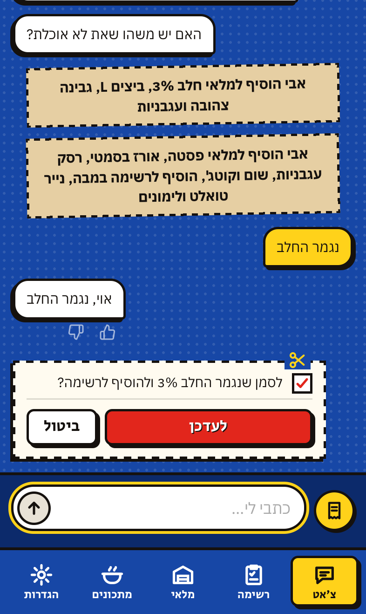
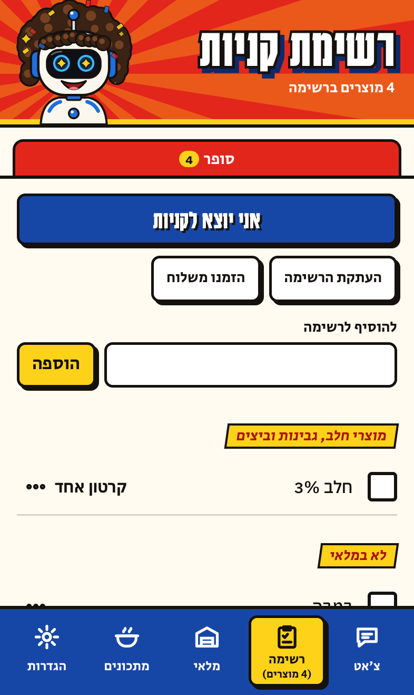
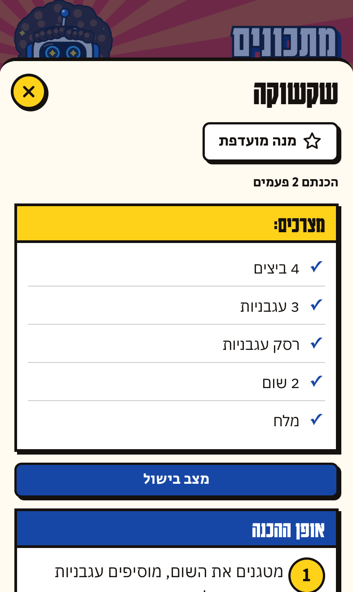
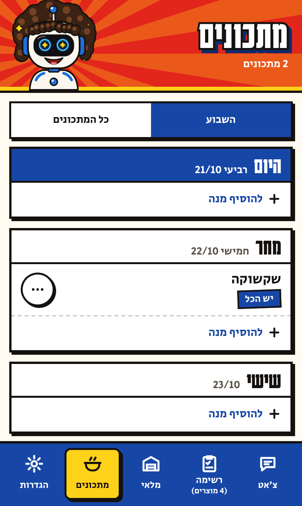

# Shuki

**For a household that shares one kitchen.** Shuki keeps track of what's at home and what to buy: you tell him in a Hebrew chat ("the milk ran out"), he proposes the change, and nothing changes until someone in the house approves.

<div dir="rtl">

**לבית שחולק מטבח אחד.** שוקי יודע מה יש בבית ומה צריך לקנות: כותבים לו בצ'אט ("נגמר החלב"), הוא מציע את השינוי ושום דבר לא משתנה עד שמישהו מהבית מאשר.

</div>

A web app (PWA) for iPhone, for everyone in the house. The app speaks Hebrew only. The brain is Claude (Anthropic) or ChatGPT (OpenAI), with your own API key, and the server is yours: Cloudflare Workers + D1, Node.js / Docker with one SQLite file, or Vercel / Netlify with Turso.

[עברית בהמשך](#עברית)

| Chat with a card | The shopping list | The inventory | A recipe | The week |
|---|---|---|---|---|
|  |  |  |  |  |

The screenshots are of a made-up test house, with a fake model, in an iPhone-sized browser (Playwright, WebKit).

## What it does
- **Inventory and list:** what's in the house, where, how much, until when. Things below their minimum go on the list by themselves.
- **Chat with approval cards:** Shuki proposes, a person approves. Questions are answered right away. Undo is always one tap.
- **Shopping mode:** one person shops, the others' additions reach them live. Works offline in the supermarket.
- **Learning:** how fast each thing runs out, and rules the house teaches him ("we don't count spices"). He also notices habits on his own (the amount someone always adds, a weekly buy, who does which store, a suggestion that keeps getting turned down): defaults change quietly, anything else waits for a yes. Everything learned is listed in settings and stored only in the house's database. 👍 / 👎 on any answer.
- **Recipes and the week:** saved from text, a photo or a link; "what's missing for shakshuka?", scaling to more people, a plan for the week's dinners with one card for what's missing.
- **Other assistants (MCP):** each person can make a secret address and use Shuki from Claude, ChatGPT or any MCP client.
- **Reminders:** expiry dates, a monthly summary, medicines, leftovers. Quiet hours 23:00–07:00, and an optional Shabbat mode.
- **Personality:** a small tamagotchi-like robot. Plain answers for routine reports, a moment of joy after good things (a finished shop, a meal cooked), a quick cry when something is thrown away. Never a lecture.
- **Roles:** admin, adult, child (a child's additions wait for an adult). Roommate mode (shared or personal items).
- **Backups:** nightly, a week back; download a backup file to move servers; CSV export.

## What you need
- **A server.** The easiest is a [Cloudflare](https://dash.cloudflare.com/sign-up) account: Shuki uses one Worker, one D1 database and one cron trigger (every hour). The free plan has all three, but Shuki hasn't been measured against its limits; see [Cloudflare's pricing](https://developers.cloudflare.com/workers/platform/pricing/). Or any machine that runs Node.js 22.13+ or Docker.
- **A model key:** [Anthropic](https://console.anthropic.com/) (Claude: the default, and the one Shuki was tested with) or [OpenAI](https://platform.openai.com/) (ChatGPT, see [Known limitations](#known-limitations)).
- **HTTPS**, so phones can install the app and get notifications (Cloudflare, Render, Railway, Fly.io, Vercel and Netlify give you that).

**What the model costs.** Measured in one house in October 2026, on Claude Sonnet 5 (the default): about **$0.05 per message** to Shuki ($4.45 for 84 messages, later $5.69 for 102). So a house that writes to him 100 times a month pays Anthropic about $5 a month. Some answers need no model at all (undo, buttons, "forget what I said"), and the screens (list, inventory, recipes) never call it. The chat stops at a monthly cap, $10 by default (`MONTHLY_COST_CAP`; the admin can change it in the app); at the cap the chat rests and the screens keep working. Set a spending limit in your provider's console too. ChatGPT's cost wasn't measured.

## Install
One house per installation. The server's address is the app's address: open it, type the one-time setup code, create the house, add a Claude or ChatGPT key, and hand out pairing codes.

Steps are marked ✅ when they were run on a Mac (Node.js 25.6, npm 11.9) on 21/10/2026, from this repository, and ☁️ when they need an account: checked against the code, not run.

### Try it on your computer first ✅
```
git clone https://github.com/OhadTheFox/shuki shuki && cd shuki
npm ci
npm start
```
`npm start` runs the server on Node.js with a SQLite file (`./data/shuki.db`), runs the migrations and prints `shuki: a new house. Setup code 12345678: open the app and type it in` (with its own 8 digits). Open http://localhost:8787 in a browser and type the code. Without a model key the chat can't answer; add a key on the setup screen or later in settings. `PORT` and `DB_PATH` change the port and the file.

The Cloudflare version, locally (Wrangler, with D1 on disk): ✅
```
npx wrangler d1 migrations apply DB --local
npm run dev
```
It serves http://localhost:8787 and prints `shuki: setup code …` in that terminal the first time the app is opened.

### Pick a route

| Route | For | Database |
|---|---|---|
| [1. Cloudflare, one click](#1-cloudflare-one-click) ☁️ | Most people | D1 |
| [2. Cloudflare from a terminal](#2-cloudflare-from-a-terminal) ☁️ | Developers, GitHub Actions | D1 |
| [3. Docker](#3-docker) | A home server, a NAS, a Raspberry Pi | a file on a volume |
| [4. Any Node.js host with a disk](#4-any-nodejs-host-with-a-disk) ☁️ | Render, Railway, Fly.io, a VPS | a file on a disk |
| [5. Vercel / Netlify](#5-vercel--netlify-no-disk) ☁️ | Serverless hosts without a disk | Turso (libSQL) |

On your own machine (3, or 4 on a VPS), put it behind Caddy, a Cloudflare Tunnel or Tailscale for HTTPS, and set `TRUST_PROXY=1`.

### 1. Cloudflare, one click
[](https://deploy.workers.cloudflare.com/?url=https://github.com/OhadTheFox/shuki)

Cloudflare copies the repository to your GitHub, creates the database, runs the migrations and deploys.
It asks for `SETUP_CODE` (described in `package.json`): 8 digits you choose, typed in the app once to create the house. The address is `https://shuki.<your subdomain>.workers.dev`. ☁️ This button hasn't been tried yet.

### 2. Cloudflare from a terminal
```
./deploy.sh
```
It logs in (a browser opens), creates the D1 database and push keys, runs the migrations, deploys, and asks for a model key (optional). ☁️

Or deploy from GitHub: `.github/workflows/deploy.yml` runs `npm ci`, `npm test` and `tools/ci-deploy.sh` on every push to `main`
(secrets: `CLOUDFLARE_API_TOKEN`, `CLOUDFLARE_ACCOUNT_ID`; optional `ANTHROPIC_API_KEY` / `OPENAI_API_KEY`, `SETUP_CODE`, `VAPID_PRIVATE_JWK`).
Without `CLOUDFLARE_API_TOKEN` (a fork, or this repository) it runs the tests, deploys nothing and ends green.
In a public repository the workflow never prints setup or pairing codes, or the address; set `SETUP_CODE` as a secret.

### 3. Docker
From the code: ✅
```
docker compose up -d --build
docker compose logs shuki          # the one-time setup code
```
A ready image, once the maintainer has published one (`.github/workflows/docker.yml` builds it on a release tag, or by hand): ☁️
```
docker run -d --name shuki -p 8787:8787 -v shuki-data:/data --restart unless-stopped ghcr.io/ohadthefox/shuki:latest
docker logs shuki                  # the one-time setup code
```
The image is built for amd64 and arm64 (Raspberry Pi, Synology / QNAP / Unraid NAS, Apple silicon). On a NAS, add it in the
Docker / Container app with port 8787 and a folder mapped to `/data`.

### 4. Any Node.js host with a disk
Node.js 22.13 or newer, nothing else to install: `npm start`. The database is one SQLite file at `DB_PATH`; it must be on a
disk that survives restarts and deploys. ☁️
- **Render:** New → Web Service from the repository. Build command: none. Start command: `npm start`. Add a Disk
  (mount path `/var/data`) and set `DB_PATH=/var/data/shuki.db`. Disks need a paid instance.
- **Railway:** New project from the repository. Add a Volume mounted at `/data`, set `DB_PATH=/data/shuki.db`. Start command: `npm start`.
- **Fly.io:** `fly launch` (it uses the Dockerfile; answer no to databases), then `fly volumes create shuki_data --size 1` and in
  `fly.toml`: `[mounts] source = "shuki_data"` `destination = "/data"`. Keep one machine: `fly scale count 1`.
- **A VPS:** the Docker route, or `npm start` under systemd, behind Caddy (`caddy reverse-proxy --from shuki.example.com --to :8787`).

The setup code is in the host's logs. Run a single copy: the database is a file.

### 5. Vercel / Netlify (no disk)
These hosts have no disk, so the database is [Turso](https://turso.tech) (libSQL, SQLite over the network): ☁️
```
turso db create shuki
turso db show shuki --url            # → DATABASE_URL (libsql://...)
turso db tokens create shuki         # → DATABASE_AUTH_TOKEN
```
Then import the repository in Vercel or Netlify and set `DATABASE_URL`, `DATABASE_AUTH_TOKEN`, `SETUP_CODE`, `CRON_SECRET`
(any long random string), and optionally a model key. `vercel.json` / `netlify.toml` are already there: `public/` is the site,
`/api/*` and `/mcp/*` go to one function (`api/shuki.js` or `netlify/functions/shuki.mjs`, around `server/serverless.js`), and the migrations run on the first request.

Reminders and the evening digest need something to run every hour:
- **Netlify** does it by itself (`netlify/functions/hourly.mjs`).
- **Vercel:** its free cron runs once a day, so use an outside one, e.g. [cron-job.org](https://cron-job.org): every hour,
  `GET https://<your app>/api/cron` with the header `Authorization: Bearer <CRON_SECRET>`.

This route was tested with the same code against libSQL's local mode (`test/serverless.itest.js`), not on Vercel,
Netlify or Turso themselves.

### Environment
| Variable | What |
|---|---|
| `ANTHROPIC_API_KEY` / `OPENAI_API_KEY` | The model key. Optional: the admin can enter one in the app instead (it's tested, then kept on the server only). |
| `PROVIDER` | `anthropic` or `openai` when both keys are set. A key entered in the app picks its own provider. With both keys, when one is out of credit or down, Shuki answers with the other and tells the admin. |
| `MODEL` / `OPENAI_MODEL` | Defaults: `claude-sonnet-5`, `gpt-5.6-terra`. |
| `MONTHLY_COST_CAP` | Dollars a month for the chat (default 10; the admin can change it). At the cap the chat rests; the screens keep working. |
| `PRICE_IN` / `PRICE_OUT` | Dollars per million tokens, if your model's price differs from the defaults. |
| `SETUP_CODE` | 8 digits for creating the house. Otherwise one is generated and printed to the server log. |
| `VAPID_PUBLIC` / `VAPID_PRIVATE_JWK` / `VAPID_SUBJECT` | Push keys. Optional: without them the server makes a pair and keeps it in the database. |
| `UPDATE_REPO` | `owner/repo`: the server asks GitHub for that repository's latest release, and the admin sees in settings when it's newer. Off unless you set it. |
| `PORT`, `DB_PATH`, `TRUST_PROXY`, `RUN_SCHEDULE_ON_START` | Node.js only. |
| `DATABASE_URL` / `DATABASE_AUTH_TOKEN` | A libSQL / Turso database instead of the file (route 5; also works with `npm start`). |
| `CRON_SECRET` | Route 5: the hourly job at `/api/cron` runs only with this as a Bearer token. |
| `TEST_RESET` | Tests only. Never set it on a real server. |

## A new house
1. On first start the server prints a one-time **setup code** (or use `SETUP_CODE`).
2. Open the app, enter the code, the house name, your name, a model key and the time zone. Whoever sets up the house is its admin.
3. In settings → the house, the admin adds people. Each gets a pairing code (6 digits, 7 days, once).
   On iPhone: Safari → the address → Share → View More → Add to Home Screen → open from the icon → enter the code
   (Safari and the home-screen app don't share storage, so the code is entered inside the app).
4. Notifications: settings → turn on for this device.

## Using Shuki from another assistant (MCP)
Settings → "חיבור לעוזר אחר" makes a secret address, `https://<your server>/mcp/<token>`, for the person who made it. Add it as a remote MCP server (in Claude: Settings → Connectors → Add custom connector). Tools: what's at home, the shopping list, add to the list, ran out, bought, and a free message to Shuki. Plain actions are carried out at once and show in the log as "(via Claude)"; what Shuki proposes from a message waits for approval in the app. The token can also be sent as `Authorization: Bearer <token>` to `/mcp`, which keeps it out of URLs and logs. Only a hash of the token is stored; each connection can be cut off in settings, and removing someone from the house cuts off theirs. Requests carrying a browser `Origin` from another site are refused (`worker/mcp.js`).

## Privacy
Only what the code does, with the file that does it. (The app's own privacy link points here.)

### Where the data is
- The author runs no service and receives no data. Each install is run by the house that installed it, which is responsible for it.
- The house's data lives only on your server: D1, the SQLite file (`server/node.js`), or on route 5 your own Turso database. Shuki sends no telemetry, and the app loads nothing from third parties (`public/_headers`).
- Chat messages are deleted from the server after 90 days (`worker/index.js`, the daily run). The log, the inventory, purchase history, 👎 notes, the patterns Shuki notices ("only Michal adds X"), product and recipe photos and what was learned stay until they are deleted or the house is.
- A copy of the house is made every day and the last 7 are kept, on your server. Copies don't include the chat (`worker/house.js`).
- The model key is kept in your database, on your server, and never reaches the phones. Wrong pairing tries keep the address they came from for 24 hours.
- Your host's logs (Cloudflare Workers Logs is on in `wrangler.toml`) get each error with the person's number in the house (not the name), the phone's error text and its browser; on a new install with no `SETUP_CODE`, the setup code is printed there. The server also logs a few safety events with the person's number: a curse removed from an answer (with the words), an eating-disorder sentence removed, an offer to tell others removed, the writer's own name removed (`worker/shuki.js`). Turn the logs off in `wrangler.toml` (`[observability]`) if you don't want them.

### What goes to the model
- When someone writes to Shuki, this goes to the model provider you chose (`worker/shuki.js`, `worker/llm.js`): the message (and a photo, if taken), up to the last 12 chat messages from today (the writer's own chat and the house's), the inventory and its state, the list, recent actions in the house, the names of the people in the house and how to address them, the house notes, saved recipes, the lessons the house taught Shuki, what Shuki learned about the people in the house (what the house may see), the writer's own private facts, and for questions about the past, purchase history.
  Not sent: tokens, codes, push subscriptions, or keys.
- What the provider does with API data is governed by its own terms: [Anthropic](https://www.anthropic.com/legal), [OpenAI](https://openai.com/policies).
- The messages go to the provider in the US. A house in the EU creates its D1 database in Europe, before the first deploy: `npx wrangler d1 create shuki --jurisdiction eu` (route 2), with its id in `wrangler.toml`. Also remove or change `[placement]` in `wrangler.toml`: it runs the Worker in the US, next to a US database.
- A recipe link sent in the chat is fetched by your server (public `https` pages only; addresses inside your network are refused, `worker/pages.js`) and its text goes to the model with the message.
- An assistant you connect over MCP sees what its tools return (the inventory, the list) and acts as you. That assistant's own terms apply to it.

### Personal messages
- A personal message (one that says "בינינו" or "סוד", or one Shuki recognizes as personal: pregnancy, health, a surprise) and Shuki's answer stay in the writer's own chat. Others in the house see only a change to the inventory, if one was made, and only what can be the writer's alone is kept (`worker/secret.js`). The message is still sent to the model provider, like any other. The message and the answer are deleted after 7 days.
- Some products are private to whoever added them: by a fixed list (contraception and the like), or when asked in so many words (`worker/private.js`).
- What Shuki learned that is private (pregnancy, health, or what was said as a secret) is shown only to that person, in "מה למדתי". It is not in the daily backup or in anyone else's download.
- Someone can tell Shuki something about another person in the house; about another grown-up it waits for that person to confirm it, except an allergy, which is used at once; what a grown-up says about a child is kept at once. Guests of a hosting (their names and what they eat) go to the model in the grown-ups' messages.
- Health, pregnancy, kashrut and Shabbat can count as sensitive data.

### Leaving and deleting
- "תשכח מה שאמרתי" in the chat deletes your last message and what Shuki learned from it. A fact in "מה למדתי" can be deleted by the person it's about (a grown-up can also delete the house's and a child's).
- Anyone in the house can leave by themself, on their own page in settings. A person's own download (settings → backup) also has their own chat and their private facts, and only theirs.
- When someone leaves the house (by themself, or the admin takes them out), their private chat, what Shuki knew about them and their private products are deleted, with their private log lines; a log line that starts with their name says "מי שגר כאן" instead, and someone who joins later with the same name is a new person, with nothing of theirs. Deleting the house deletes everything, the logs too.
- 👎 on an answer keeps only Shuki's answer and your explanation, on your server. It is included in backups.

## Safety

### Children
- Add a child only as their parent or with a parent's consent, and check your model provider's rules about minors.
- A child's additions wait for an adult. Grown-ups can see a child's chat with Shuki, and the child is told so.
- Shuki doesn't keep a child's pregnancy or health, also when the child asks him to remember it.
- After a child's message in distress, the parents don't see that child's messages for 24 hours (`worker/distress.js`).

### Distress and hotlines
- The server checks every message for distress first, before any other route and any limit (`worker/distress.js`). A sure phrase (wanting to die, self-harm, being hit at home) is answered with fixed words written in advance, without the model. A message that only might be distress goes to the model, which decides. Like the rest of the writer's own chat, the message and the answer can be among the recent messages sent to the model with that person's next message the same day.
- The answer gives Israeli numbers: ERAN 1201 (emotional first aid, any hour), Magen David Adom 101, the police 100, the family-violence line 118, and for a child hurt online, 105. Shuki is not an emergency service.
- A message in distress and its answer are kept only in the writer's chat, marked sensitive, and deleted after 7 days. Nobody in the house is told, not even a parent. An answer to a message in distress has no 👍/👎.

### Eating disorders
- When someone tells Shuki about an eating disorder of their own, he answers warmly, with no numbers, and suggests talking to a professional or someone close; he never offers to tell anyone else (`worker/shuki.js`, the instructions). He asks once whether to remember it; only after a yes is it kept, as "no calories and weight", private to them (`worker/facts.js`).
- From then on, the server checks each answer to that person: a goal, a target, weight, calories, weight loss or an eating plan is sent back to the model once, and if it's still there, those sentences are removed (`worker/curses.js`, `edTalk`).

### Curses
- Shuki doesn't curse, also when the person writing does. The server checks each answer for Hebrew and English curse words, as whole words (a kitchen app: "כוס" alone is a cup); an answer with one goes back to the model once, and if the second answer curses too, those sentences are removed, or a fixed sentence is said instead (`worker/curses.js`).

### Not advice
- Shuki gives no medical or nutritional advice. An allergy check can be wrong.
- In a security incident: replace the model key, disconnect the phones and tell the people in the house.

## Security
- Devices pair with one-time codes, rate limited (5 wrong tries per address per 15 minutes, 20 per hour overall; a wrong try counts also while the overall limit is on). While the overall limit is on, only a code made in the last 15 minutes works. A code for a child's new phone is made only when the child has no phone connected (a grown-up may have a second phone), and someone who gets another phone connected as them is told, in the chat and by push. Unpairing deletes the device's token and everything the app kept on that phone.
- Each model call first holds an estimate of what it may cost, by its size, against the monthly cap; a person can make Shuki think about 30 times a minute (`CHAT_PER_MINUTE`, Cloudflare and Node only) and a connected assistant 10, and a model call gives up after a minute.
- Push notifications go only to the browsers' push services (FCM, Apple, Mozilla, Windows; `PUSH_ALLOW` adds a self-hosted one, Cloudflare and Node only), with a 5-second timeout and no redirects.
- An assistant connected over MCP, or a photo, can't teach Shuki a rule or answer his questions: those wait for approval in the app.
- Only the admin can change house-wide settings.
- A recipe page's text is marked for the model as content, not instructions. "Away" is asked before it's set. Names in the house (products, recipes, leftovers) are kept on one line, so they can't pose as Shuki's own instructions.
- Recipe links: `https` only, no ports, IP addresses or local names; on Node the connection goes only to an address checked as public (IPv4-mapped and NAT64 forms included).
- CSV exports are protected against formula injection. A strict Content Security Policy and security headers on the app (`public/_headers`, and the Node server).

Found a security issue? See [SECURITY.md](SECURITY.md): report it privately, not in a public issue.

## Known limitations
- **Hebrew only.** The app, Shuki's instructions and the safety checks (distress, curses, eating) are written for Hebrew. The hotline numbers are Israeli.
- **The model.** Shuki was built and tested with Claude Sonnet 5. ChatGPT works through the same interface (`worker/llm.js`), but the real ChatGPT ran only once, on an early version (30/09/2026: 9 scenarios, 8 passed). This version wasn't tested with it, and its cost wasn't measured.
- **Phones.** Built for iPhone (Safari, Add to Home Screen). The UI tests run in Playwright's iPhone emulation (Chromium and WebKit), not on a real device. Android wasn't tested.
- **Not tried yet:** the Deploy to Cloudflare button, the Cloudflare free plan's limits, Vercel, Netlify and Turso themselves, and the ready Docker image.
- **One house per install.** Run one copy of the server.
- The model can get things wrong. That's why every change waits for a person to approve it, and undo is one tap.

## Tests
```
npm ci
npm test                                          # unit tests (domain rules, time zones, reminders, safety words)
node test/round20.itest.js                        # integration: a local server with a FAKE model (one file per area)
test/ui-qa.sh test/r19-ui.cjs                     # UI in an iPhone-sized browser (Playwright), fake model
bash test/e2e-onboarding.sh                       # the first meeting through the app, against the REAL model
bash test/stories-e2e.sh [S01,S05]                # user stories through the app, REAL model, a separate judge
test/real-eval.sh claude-sonnet-5 out.txt test/real-r19.eval.js   # single scenarios against the real model
```
`npm test` ✅: 253 tests; 247 pass and 6 skip themselves here, because they read internal run records that aren't in this repository.
What each kind of test proves: the integration and UI tests use a fake model with answers written in advance, so they
check the server and the app, not what the model says. Only the last three talk to the real model, and they cost money. The UI tests need
[Playwright](https://playwright.dev) installed globally (`npm i -g playwright`). The shell scripts expect Linux tools (`setsid`, `timeout`): on a Mac, run them on Linux or install those tools first, and `test/real-eval.sh` stops every `wrangler` running on the machine. The user stories (`test/stories/r20.json`) were
written by a separate agent, and each run is judged by a separate model.
The integration and UI tests run against `wrangler dev` with `TEST_RESET=1`. Don't run two of these at the same time:
they all start local servers.

## Contributing
Bug reports, ideas and pull requests are welcome.
- **A bug:** open an issue with what you did, what you expected, what happened, and the install route (Cloudflare, Docker, Node, Vercel, Netlify). Leave out names, keys, codes and anything from your house's chat.
- **A security issue:** privately, as in [SECURITY.md](SECURITY.md).
- **A pull request:** keep it small, add a test next to the code (`test/`), and make sure `npm test` passes. Text that people see is in Hebrew, written the way an Israeli writes to someone at home, not a translation.

## Credits
Built by **Ohad Zaidenberg** ([@OhadTheFox](https://github.com/OhadTheFox)).

Shuki is named after a good friend, "Shuki". The afro is an inside joke.

The character and the app's icons were made with ChatGPT, from the visual of Babel, a project of Ohad's.

## License
[MIT](LICENSE). The fonts are under the SIL Open Font License: Karantina, IBM Plex Sans Hebrew and Secular One (`public/fonts/OFL-*.txt`).

This public repository is made by a script in the private repository it comes from, as one commit, with internal notes left out. The private repository is never made public.

---

<div dir="rtl">

## עברית

**שוקי** הוא רובוט קטן שמנהל את המלאי של הבית. זו אפליקציית ווב לאייפון, משותפת לכל מי שגר בבית. כותבים לו בצ'אט ("נגמר החלב", "יש לנו טונה?" או צילום של חשבונית) והוא מציע שינויים במלאי וברשימת הקניות. שום דבר לא משתנה בלי אישור של מישהו מהבית.

### מה הוא עושה
- **מלאי ורשימה:** מה יש בבית, איפה, כמה ועד מתי. מה שיורד מתחת למינימום נכנס לרשימה לבד.
- **צ'אט עם כרטיסים לאישור:** שוקי מציע ואתם מאשרים. על שאלות הוא עונה מיד. אפשר לבטל כל דבר בלחיצה אחת.
- **מצב קניות:** מי שבסופר רואה מיד מה האחרים הוסיפו. זה עובד גם בלי קליטה.
- **למידה:** כמה מהר כל מוצר נגמר וכללים שאתם מלמדים אותו ("תבלינים לא סופרים"). כל מה שהוא למד מופיע בהגדרות ונשמר רק במסד הנתונים של הבית.
- **מתכונים והשבוע:** שומרים מתכון מטקסט, מצילום או מקישור, שואלים "מה חסר לשקשוקה?" ומתכננים את ארוחות הערב של השבוע עם כרטיס אחד למה שחסר.
- **תזכורות:** תאריכי תוקף, סיכום חודשי, תרופות ושאריות. בלי התראות בין 23:00 ל-07:00. יש גם מצב שבת.
- **תפקידים:** מנהל, מבוגר וילד (מה שילד מוסיף מחכה לאישור של מבוגר). יש גם מצב שותפים.
- **גיבויים:** כל לילה, שבוע אחורה. אפשר גם להוריד קובץ גיבוי.

### מה צריך
- **שרת.** הכי פשוט: חשבון [Cloudflare](https://dash.cloudflare.com/sign-up). שוקי משתמש ב-Worker אחד, במסד נתונים D1 אחד ובהפעלה מתוזמנת אחת שרצה כל שעה. כל אלה קיימים בתוכנית החינמית, אבל עוד לא בדקנו את שוקי מול המגבלות שלה. אפשר גם להשתמש בכל מחשב שמריץ Node.js 22.13 ומעלה או Docker.
- **מפתח למודל:** Anthropic (Claude: ברירת המחדל והמודל שאיתו שוקי נבדק) או OpenAI (ChatGPT).
- **HTTPS**, כדי שתוכלו להתקין את האפליקציה בטלפון ולקבל התראות.

**כמה זה עולה.** לפי המדידה בבית אחד, באוקטובר 2026, עם Claude Sonnet 5: בערך **$0.05 להודעה** לשוקי. בית שכותב לו 100 פעמים בחודש ישלם ל-Anthropic בערך $5 לחודש. המסכים (רשימה, מלאי ומתכונים) לא פונים למודל בכלל. הצ'אט נעצר בתקרה חודשית, $10 כברירת מחדל. אתם יכולים לשנות אותה באפליקציה. כדאי להגדיר מגבלת הוצאה גם אצל ספק המודל.

### התקנה
קודם כדאי לנסות במחשב שלכם:
```
git clone https://github.com/OhadTheFox/shuki shuki && cd shuki
npm ci
npm start
```
השרת ידפיס קוד הקמה של 8 ספרות. פתחו את http://localhost:8787, הקלידו את הקוד, צרו את הבית והדביקו מפתח של Claude או ChatGPT. אחר כך תוכלו לחלק לחברי הבית קודי חיבור מההגדרות.

כשאתם מוכנים, בחרו מסלול אחד (הפירוט באנגלית, בפרק Install):

1. **Cloudflare בלחיצה:** הכפתור "Deploy to Cloudflare". הוא מעתיק את הריפו ל-GitHub שלכם, יוצר את מסד הנתונים ומעלה את האפליקציה. הוא יבקש את `SETUP_CODE`: 8 ספרות שתבחרו ותקלידו באפליקציה כדי להקים את הבית. את הכפתור עוד לא ניסינו.
2. **Cloudflare מהטרמינל:** `./deploy.sh`, או GitHub Actions בכל push ל-`main`.
3. **Docker:** `docker compose up -d --build`. קוד ההקמה מופיע ב-`docker compose logs shuki`. מתאים גם ל-Raspberry Pi ול-NAS.
4. **כל שרת Node.js עם דיסק** (Render, Railway, Fly.io, VPS): `npm start`, עם `DB_PATH` על דיסק שלא נמחק כשהשרת מופעל מחדש או מתעדכן.
5. **Vercel או Netlify (בלי דיסק):** מסד נתונים ב-Turso. המסלול הזה נבדק רק מול libSQL מקומי.

במחשב בבית תצטרכו HTTPS דרך Caddy, Cloudflare Tunnel או Tailscale. הגדירו גם `TRUST_PROXY=1`.

### פרטיות ובטיחות
- המחבר לא מפעיל שום שירות ולא מקבל שום מידע. כל התקנה שייכת לבית שהתקין אותה ואחראי לה.
- הנתונים נשמרים רק בשרת שלכם. שוקי לא שולח טלמטריה. `UPDATE_REPO` כבוי עד שתגדירו אותו.
- כשכותבים לשוקי, נשלחים לספק המודל ההודעה, עד 12 הודעות אחרונות מהיום, המלאי, הרשימה והשמות של חברי הבית. הפירוט המלא נמצא באנגלית, תחת Privacy. ההודעות יוצאות לספק בארה"ב.
- הודעות הצ'אט נמחקות מהשרת אחרי 90 יום. הודעה אישית ("בינינו", "סוד", הריון או בריאות) נשארת רק בצ'אט של מי שכתב אותה ונמחקת אחרי 7 ימים.
- **מצוקה:** השרת בודק בכל הודעה סימני מצוקה, לפני כל דבר אחר. על משפט ברור של מצוקה עונים במילים קבועות, בלי המודל. כמו שאר הצ'אט של מי שכתב, ההודעה והתשובה יכולות להישלח למודל עם ההודעה הבאה שלו באותו יום. התשובה כוללת את ער"ן (1201), מד"א (101), המשטרה (100), הקו לאלימות במשפחה (118) ואת 105 לילד שנפגע ברשת. ההודעה נשארת רק אצל מי שכתב אותה ונמחקת אחרי 7 ימים. אף אחד בבית לא מקבל עליה הודעה, גם לא ההורים. שוקי הוא לא שירות חירום.
- **הפרעות אכילה:** למי שסיפר לו על הפרעת אכילה שלו, שוקי עונה בחום ובלי מספרים. הוא מציע לדבר עם איש מקצוע או עם מישהו קרוב. אם האדם אישר ששוקי יזכור את זה, השרת מוריד מכל תשובה אליו משקל, קלוריות, יעדים ותוכניות אכילה.
- **קללות:** שוקי לא מקלל, גם כשכותבים לו בקללות. תשובה עם קללה חוזרת למודל פעם אחת. אם הקללה עדיין שם, המשפט נמחק.
- **ילדים:** הוסיפו ילד רק אם אתם ההורים שלו או בהסכמה של הורה. בדקו גם מה הכללים של ספק המודל לגבי קטינים. המבוגרים רואים את הצ'אט של הילד והוא יודע את זה. שוקי לא שומר מידע על הריון או בריאות של ילד, גם כשהילד מבקש.
- שוקי לא נותן ייעוץ רפואי או תזונתי. בדיקת אלרגיה יכולה לטעות.
- כל אחד יכול לצאת מהבית בעצמו, מהדף שלו בהגדרות. "תשכח מה שאמרתי" מוחק את ההודעה האחרונה ואת מה ששוקי למד ממנה.
- באירוע אבטחה: החליפו את מפתח המודל, נתקו את הטלפונים וספרו לחברי הבית. על בעיית אבטחה בקוד מדווחים בפרטיות, לפי [SECURITY.md](SECURITY.md).

### מגבלות
- עברית בלבד. מספרי הטלפון לעזרה הם ישראליים.
- שוקי נבנה ונבדק עם Claude. ChatGPT רץ רק פעם אחת, על גרסה מוקדמת. הגרסה הזו לא נבדקה איתו.
- שוקי נבנה לאייפון. הבדיקות רצות בדפדפן שמדמה אייפון ולא במכשיר אמיתי. באנדרואיד לא בדקנו.

### רוצים לעזור?
מצאתם באג? פתחו issue וכתבו מה עשיתם, מה ציפיתם שיקרה ומה קרה בפועל. אל תצרפו שמות, מפתחות, קודים או קטעים מהצ'אט של הבית. רוצים לתרום קוד? שלחו pull request קטן עם בדיקה. ודאו ש-`npm test` עובר.

### קרדיטים
נבנה על ידי אוהד זיידנברג (Ohad Zaidenberg).

שוקי נקרא על שם חבר טוב, שוקי. האפרו הוא בדיחה פנימית.

הדמות והאייקונים של האפליקציה נוצרו ב-ChatGPT, מהוויז'ואל של Babel, פרויקט של אוהד.

רישיון MIT.

</div>
